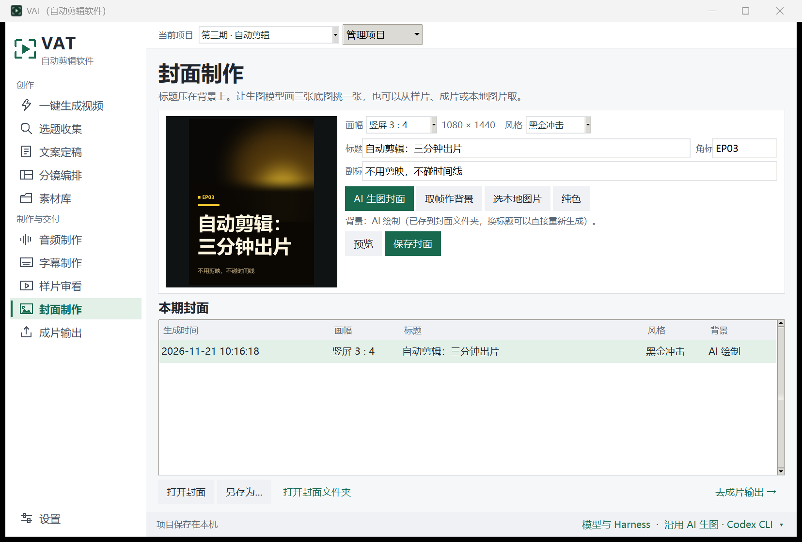
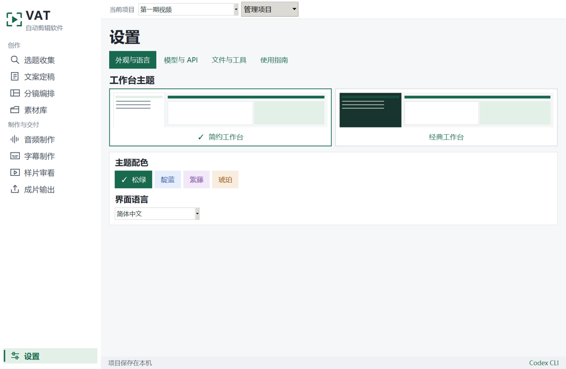

# VAT 自动剪辑软件

VAT 是一款本地桌面剪辑工作台。可以从文案拆出分镜，按镜头编排图片、视频和口播，导入 SRT，混音并导出 MP4。项目、缓存和导出文件都保存在当前用户选择的工作区。

## 运行环境

- **Windows x64 打包版**可以直接运行 `VAT.exe`。
- **Windows、macOS 和 Linux 源码版**需要带 Tk 的 Python 3.11 或更高版本，并安装 `requirements.txt` 中的依赖。详见[从源码启动](#从源码启动)。
- **合成样片和导出成片**需要安装同一套 FFmpeg 和 FFprobe。请选择带 `libx264`（H.264）、`aac` 编码器和 `ass` 字幕滤镜（libass）的版本。将两个程序所在目录加入 PATH，或到「设置 → 文件与工具 → FFmpeg 目录」指定该目录。Linux 上请安装支持中文的字体，例如 Noto Sans CJK。
- **AI 与配音**按需配置。手工编辑可以直接开始。使用 AI 写稿、拆镜或生图时，先连接对应模型。需要合成配音时，到「音频制作 → 配音设置」配置所用的本机服务或 API。

## 功能概览

制作时可点「中断并保存」，关闭软件时也会先保存再退出。「一键生成视频」可在重新打开项目后点「继续制作」，复用已完成的步骤、图片、配音和镜头。

「一键生成视频 → AI 生图」支持 Codex CLI 原生生图，也可选择支持生图的 OpenAI 兼容或 Gemini API。Codex 沿用本机账户登录，生成的图片自动保存到项目的「原创素材」。

「封面制作」在样片审看之后：选画幅、标题和风格，让生图模型一次画三张构图不同的底图挑一张（也可从成片取帧、选本地图片或纯色），保存后得到一张独立 PNG。生图沿用「一键生成视频」里配好的 AI 生图通道，封面、背景图与生成记录都留在工作区「封面」目录，可以换标题重做。





## 第一次使用

1. **打开工作台。** 按上面的运行环境选择启动方式。
2. **先看新手教程。** 启动时会先介绍运行环境，再讲解四种配置方式。你可以导入 API、把软件位置交给 agent 配置、调用本机的 Codex 或 DeepSeek Harness，或填写本地语音服务地址。勾选「启动时不再显示」后，仍可在「设置 → 使用指南」里重新打开。
3. **打开左下角的「设置」。** 选择外观、配色和界面语言，确认工作区、素材输入目录和剪辑所需的工具路径。
4. **制作第一条视频。** 有带原声的视频和对应 SRT 时，从「音频制作 → 导入 SRT 和口播视频」建立口播分镜。在「样片审看」合成预览，「封面制作」出一张封面，校对后到「成片输出」导出。也可以从「选题收集」开始写稿。详见[使用说明](使用说明.md)。

## 从源码启动

在下载并解压的源码目录打开终端。可先运行 `python -m tkinter` 检查能否显示桌面窗口。macOS、Linux 上的命令通常叫 `python3`。Debian / Ubuntu 系统 Python 可安装对应版本的 `python3-tk` 和 `python3-venv`。

**Windows PowerShell**

```powershell
py -3 -m venv .venv
.\.venv\Scripts\python -m pip install -r requirements.txt
.\.venv\Scripts\python studio.py
```

**macOS / Linux 桌面**

```sh
python3 -m venv .venv
.venv/bin/python -m pip install -r requirements.txt
.venv/bin/python studio.py
```

## 选择模型

新工作区的模型与配音设置初始为空。请在「设置 → 模型与 API」连接自己的模型，在「配音设置」选择自己的本机音色 JSON，或填写自己的语音 API。

使用 ElevenLabs 配音时，打开「音频制作 → 配音设置」，选择「语音 API」，将「语音服务」设为「ElevenLabs」。官方地址和默认模型会自动填入；填写自己的 API Key 和音色 Voice ID，测试后保存即可。

没有专用语音模型时，可在「配音设置」选择「大语言模型配音（API / 本地）」，接入能够直接返回音频的云端模型或本地 vLLM-Omni。

| 已有条件 | 适合的设置 | 需要填写 |
| --- | --- | --- |
| 已在本机使用 Codex CLI 或 DeepSeek Harness | 选对应的 CLI 通道 | 命令可从 PATH 检测，也可选择本机可执行文件。登录沿用当前用户自己的 CLI 账户。 |
| 希望在本机处理文案 | 启动 Ollama 或 LM Studio，再使用 OpenAI 兼容协议 | 填本机服务的 Base URL 和已加载的模型 ID。Ollama 常用 `http://localhost:11434/v1`，LM Studio 常用 `http://localhost:1234/v1`。模型权重由本机推理软件加载。[Ollama 指南](https://docs.ollama.com/api/openai-compatibility) · [LM Studio 指南](https://lmstudio.ai/docs/developer/openai-compat) |
| 希望使用云端服务 | 新增直连 API 配置 | 填接口地址和服务要求的密钥，再选模型或 Agent 的调用 ID。常见协议可根据地址识别，也可在高级选项指定。|

点「读取列表」查询目录，或直接填写调用 ID。可设置「模型」或「Agent」标记及显示名，方便在各制作步骤选择。「测试连接」会实际发出一次请求，云端服务可能计费。执行 AI 操作时，相应的文案、台词或用于选材的文件名会交给所选服务。使用 GitHub、Wikimedia 或抖音选题来源时也需要网络。

已经有单文件 GGUF 聊天模型时，可以直接在设置中选择权重文件。先安装并启动本机 Ollama，确认它在默认端口 11434 运行，然后从 VAT 发起导入。Ollama 会把权重保存到自己的模型库，需预留相应磁盘空间。导入完成后，可使用返回的模型名进行连接检测并启用。也可以连接已加载模型的其他兼容服务。[Ollama 导入说明](https://docs.ollama.com/import)

## 用户文件与换机

| 系统 | 默认工作区 |
| --- | --- |
| Windows | `%LOCALAPPDATA%\分镜工作台`，沿用旧版位置 |
| macOS | `~/Library/Application Support/VAT Studio/workspace` |
| Linux | `$XDG_DATA_HOME/vat-studio`，默认 `~/.local/share/vat-studio` |

工作区保存项目数据库、素材索引、缓存、样片和成片。素材保留在导入时的位置。关闭软件后再备份整个工作区，并单独备份原始素材。更换目录后重启即可打开选中的工作区。命令行也可用 `FENJING_HOME` 指定工作区。换机后请重新设置工具路径和 API 密钥，并检查素材路径。要将已完成的样片及引用媒体交给别人，可在「样片审看」导出 AI 制作包。

## 测试与构建

在项目虚拟环境中运行以下命令。测试使用临时项目和模拟的模型回复。运行完整音视频测试前请安装 FFmpeg 和 FFprobe。

```sh
python -m unittest discover -s tests
python -m pip install pyinstaller==6.22.3
python -m PyInstaller --noconfirm vat.spec
python make_source_zip.py
```

每个平台在本机生成自己的程序。产物在 `dist/`，Windows 为 `VAT.exe`，macOS 为 `VAT.app`，Linux 为 `VAT`。GitHub Actions 工作流会分别测试三个系统并保存构建产物。

分享源码时使用 `dist/VAT-source.zip`。源码包按清单收录程序、公开资源、文档和测试，可解压到 GitHub 仓库根目录。可执行文件可以单独放在 Releases。模型账号、密钥、模型权重、音色和项目数据由各用户在自己的电脑管理。

## 数据会去哪儿

本软件没有服务器，作者不收集、不上传任何项目数据。所有外部请求都发往你自己配置的地址：

- **模型通道**：文案、台词、镜头说明，以及用于选材的素材文件名和上级目录名，会交给所选通道（Codex CLI、DeepSeek Harness、OpenAI 兼容、Anthropic、Gemini 或本机 Ollama / LM Studio）。AI 生图会把绘制要求发给生图服务。
- **配音**：本机 GPT-SoVITS 在本地处理。选用语音 API 或大语言模型配音时，台词与音色设置会发给你填写的云端或本机接口，云端请求使用你的密钥和额度。
- **选题**：抖音选题经 Ego Lite 读取页面；GitHub 选题调用 GitHub 搜索接口并读取仓库说明；其他公开链接的选题会查询 Wikimedia Commons。
- **密钥**：用当前系统用户的凭据加密后存入本机数据库，换 Windows 用户或换机后无法解密，需要重新填写。
- **本机文件**：项目数据库、素材索引、缓存、样片与成片都在工作区（位置见上表）。删除工作区目录即删除这些数据，原始素材仍留在你导入时的位置。

完整条款见 [LICENSE](LICENSE)，第三方组件与许可见 [THIRD-PARTY-NOTICES.md](THIRD-PARTY-NOTICES.md)。

## 首次运行可能被拦截

本版未做代码签名，Windows 可能提示「Windows 已保护你的电脑」，或被杀毒软件误报——单文件打包程序的常见现象。

1. 确认文件来自本仓库的 Releases 页面；
2. 下载 `SHA256SUMS.txt`，核对哈希（PowerShell 用 `Get-FileHash .\VAT.exe -Algorithm SHA256`）；
3. 一致再运行；不一致请删除并反馈，不要运行。

卸载：删除 `VAT.exe`，再删除工作区目录即可。

## 授权与署名

免费使用，禁止售卖与修改后流出。源码包仅供查看与自行构建，**不是开源授权**。

- 完整条款：[LICENSE](LICENSE)
- 第三方组件：[THIRD-PARTY-NOTICES.md](THIRD-PARTY-NOTICES.md)，许可文本在 `third_party_licenses/`
- 版本记录：[CHANGELOG.md](CHANGELOG.md)

© 2026 酪蛋白

当前版本 v0.1.0，显示在「设置」页右上角。后续更新发布在本仓库 Releases 并同步到交流群（1134667721）。
